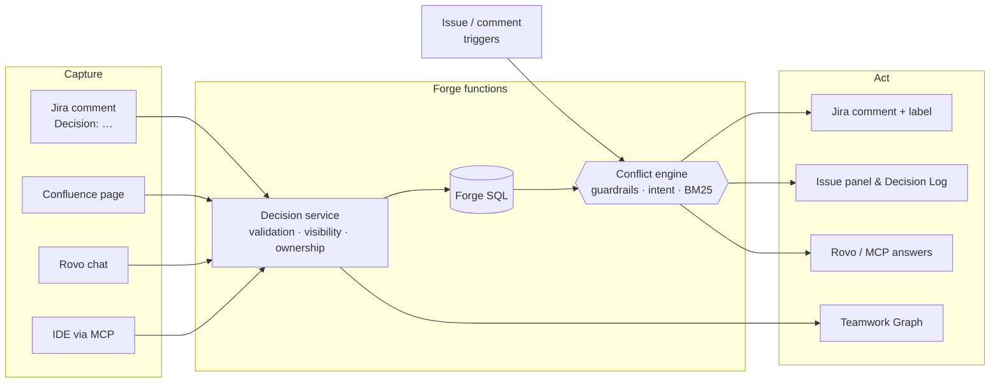
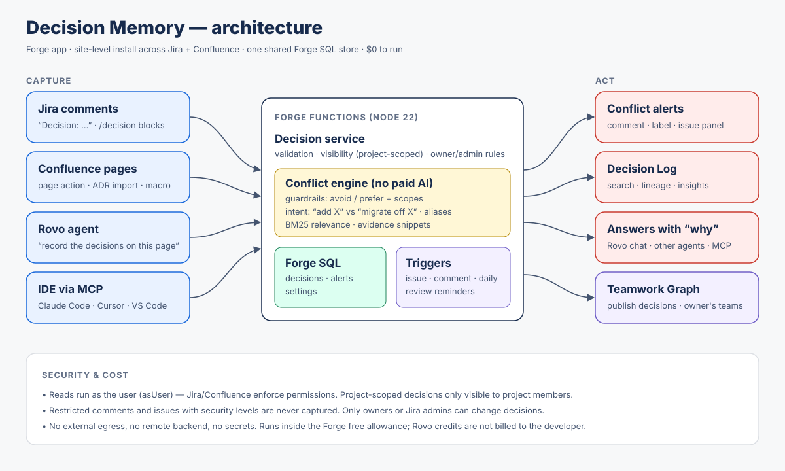

<div align="center">


# Decision Memory

### Your team already decided. Decision Memory makes sure nobody forgets.

Capture decisions where they happen in **Jira**, **Confluence**, **Rovo** and your **IDE**,<br/>
then catch new work that contradicts them, *before* it gets built.

[](https://developer.atlassian.com/platform/forge/)
[](#-rovo-agent-mcp-and-teamwork-graph)
[](docs/MCP.md)
[](#-rovo-agent-mcp-and-teamwork-graph)
[](#-development)
[](#-cost-0)
[](LICENSE)

**[▶️ Demo video](https://www.youtube.com/watch?v=txTaT7M3AVI)** · **[⬇️ Install on your site](https://developer.atlassian.com/console/install/5f7d5a1f-7d63-4e37-80ee-a2e55c108c9f?signature=AYABeMXnrrnH%2FmYekJnnvSNfdnIAAAADAAdhd3Mta21zAEthcm46YXdzOmttczp1cy13ZXN0LTI6NzA5NTg3ODM1MjQzOmtleS83MDVlZDY3MC1mNTdjLTQxYjUtOWY5Yi1lM2YyZGNjMTQ2ZTcAuAECAQB4CxqLTo9l4lqXuFjNim1xJM%2Bp%2F3TVP9xHS2BrU5DRRucBvgMpLvz6bXlqDg5UXtFRIwAAAH4wfAYJKoZIhvcNAQcGoG8wbQIBADBoBgkqhkiG9w0BBwEwHgYJYIZIAWUDBAEuMBEEDENsxSO1xuxNLeruEgIBEIA7UY9drqNIDiAKFflI3j0D19S1QWco1oU1AMpH00JB6RA9DUPQ1LR6E9fzDP6TGSCTyLectVyvmPpOeMsAB2F3cy1rbXMAS2Fybjphd3M6a21zOmV1LXdlc3QtMTo3MDk1ODc4MzUyNDM6a2V5LzQ2MzBjZTZiLTAwYzMtNGRlMi04NzdiLTYyN2UyMDYwZTVjYwC4AQICAHi9bVMAkme4qVQX1fQHo6ePw3H40A7cGfz7yrmSfBWMXgHMqQrGsaU6M9x7SEy4o3vSAAAAfjB8BgkqhkiG9w0BBwagbzBtAgEAMGgGCSqGSIb3DQEHATAeBglghkgBZQMEAS4wEQQM0NQLj%2F0TekHB1helAgEQgDshn1Ys%2FCbOLJCGySJvG%2B1UgN%2BZ%2B3ZwIALFchu94ArWfrPCKXMUBprF2ZEFRa3QWAZUETpWJznkvBPbcgAHYXdzLWttcwBLYXJuOmF3czprbXM6dXMtZWFzdC0xOjcwOTU4NzgzNTI0MzprZXkvNmMxMjBiYTAtNGNkNS00OTg1LWI4MmUtNDBhMDQ5NTJjYzU3ALgBAgIAeDYASx0XCjkny4iLV6vz%2BKtEGSGT6kdt0QRpkn6D%2FlVEAV0%2BqYCGy23B8ioBXx02lDwAAAB%2BMHwGCSqGSIb3DQEHBqBvMG0CAQAwaAYJKoZIhvcNAQcBMB4GCWCGSAFlAwQBLjARBAxY0U6qQ4gaZraKJ6QCARCAO1PRaoian7%2BZzvskjFoiHVgOLqd3%2FtcF9DfCRoWZ3%2F9wbzcXfrIzZotnNVSu3QPyF0rwnFNU0jHk5%2BUqAgAAAAAMAAAQAAAAAAAAAAAAAAAAAHrVTVuGMNGwR%2B55QjL5MYf%2F%2F%2F%2F%2FAAAAAQAAAAAAAAAAAAAAAQAAADIcfzYg3IUCds%2BewVK0dc2zmDZfBH00JYSWlLWio5WCOixEUHIc3bxoSQEBdieppQoSb9tyBhHzXfMblIYki4znhhE%3D&product=jira&product=confluence)** · **[How it works](#-how-it-works)** · **[Features](#-features)** · **[Architecture](#-architecture)** · **[Security](#-security--privacy)** · **[Quick start](#-quick-start)**

<sub>Built for <b>Atlassian Codegeist 2026</b> · Apps for Software Teams</sub>

</div>

---

## 🧠 The problem

> *"Wait, didn't we decide **not** to use MongoDB?"*

Every team makes decisions: *Postgres over Mongo*, *no Friday deploys*, *deprecate Jenkins*. They end up in comment threads, meeting notes and people's heads. Months later someone builds the opposite, and nobody notices until code review, or until the incident.

Teams lose sprints to work they already ruled out, have the same argument again in review, and ship things that break rules nobody could find.

## ✨ The solution

Decision Memory gives your organisation a **memory that speaks up**.

<table>
<tr>
<td width="33%" valign="top">

### 1️⃣ Capture
Write `Decision: …` in any Jira comment, use the `/decision` block, capture a Confluence page, import ADRs, or ask Rovo. **No new process.**

</td>
<td width="33%" valign="top">

### 2️⃣ Guard
Each decision becomes checkable **guardrails**: what to *avoid* and what to *prefer*, with optional scopes like *"(in payments service)"*.

</td>
<td width="33%" valign="top">

### 3️⃣ Catch
New issues, comments, proposals and diffs are checked automatically. A conflict gets **one clear comment** with the evidence, the reason, and the owner.

</td>
</tr>
</table>

### See it in action

Someone comments on `KAN-1`:

> **Decision:** Use PostgreSQL instead of MongoDB for all new services.

A week later, a teammate creates `KAN-2 · Add MongoDB cluster for recommendations service`. Seconds later:

> ⚠️ **Decision Memory: this work may conflict with a team decision**
>
> **DEC-1** · *Use PostgreSQL instead of MongoDB for all new services* (high confidence)<br/>
> Mentions "mongodb", which DEC-1 rules out.<br/>
> Evidence: *"add mongodb cluster for recommendations service"*<br/>
> Why it was decided: *one database to operate, transactional guarantees…*<br/>
> Decision owner: **@Vamsi Krishna**

It also **understands intent**:

| New work | Result |
|---|---|
| `Add MongoDB cluster for recommendations` | 🔴 **Conflict** with DEC-1 |
| `Replace PostgreSQL with Mongo` | 🔴 **Conflict** (the work moves *towards* the avoided tech) |
| `Migrate orders service off MongoDB to Postgres` | 🟢 **Implements** DEC-1 |
| `Deploy hotfix to production on Friday` | 🔴 **Conflict** with *"Do not deploy on Fridays"* |
| `Deploy hotfix to production on Tuesday` | ✅ No conflict |
| `Add feature flags to onboarding` | ✅ No conflict (DEC is scoped to *payments*) |

---

## 🚀 Features

### In Jira
| | |
|---|---|
| 💬 **Comment capture** | `Decision: …` lines and native `/decision` blocks become decisions, with owner, source link and guardrails. |
| 🚨 **Conflict alerts** | On issue create or edit, and on new comments (drift like *"let's just use Mongo here"*): one comment plus a `decision-conflict` label, never spam. |
| 🧩 **Issue panel** | Conflicts with evidence, decisions this issue *implements*, related decisions, acknowledge or dismiss, and **Record a decision** with a live guardrail preview. |
| 📚 **Decision Log** | Search, status filters, stats, and a detail view with rationale, owner's teams, history chain (DEC-1 → DEC-7), and supersede, revoke or edit guardrails. |
| 🔎 **Check a proposal** | Paste an RFC or PR description to test it against every active decision. |
| 📥 **ADR import** | Paste Markdown ADRs (Nygard or MADR); superseded ones are kept as history and proposed ones wait until accepted. |
| 📊 **Insights** | Conflicts caught per month, alert precision, most-protective decisions, and decision hygiene. |
| ⚙️ **Admin settings** | Auto-comment, minimum confidence, labels, comment checks, review reminders, dismissal quieting. |
| ⏰ **Review reminders** | A daily job pings owners when a decision passes its review date. |
| 🎓 **Learning loop** | Decisions whose alerts keep getting dismissed go quiet (high confidence only) and are flagged for tuning. |

### In Confluence
| | |
|---|---|
| 📄 **Capture decisions** | Page **⋯** menu: decision blocks, `Decision:` lines and ADR pages become decisions you pick from a checklist. |
| 🗂️ **Decision Log macro** | Embed the team's current decisions on any page. |

Jira and Confluence share **one installation and one database**, so a decision captured in Confluence protects Jira work immediately.

### 🤖 Rovo agent, MCP and Teamwork Graph
| | |
|---|---|
| 🤖 **Rovo agent** | *"Why do we use Postgres?"*, *"Does this issue conflict with anything?"*, *"Record the decisions on this page."* Every answer cites **DEC-n** with its source. |
| 🛠️ **6 reusable actions** | `search-decisions` · `get-decision` · `check-conflicts` · `record-decision` · `supersede-decision` · `list-due-for-review`, usable by **any** Rovo agent. |
| 🔌 **MCP server** | The same tools in **Claude Code, Cursor and VS Code**. `check-conflicts` accepts a **git diff** and inspects what you add to `package.json`, Dockerfiles, Terraform and CI config. [Setup →](docs/MCP.md) |
| 🕸️ **Teamwork Graph, both ways** | **Publishes** site-wide decisions into the graph as documents linked to their Jira issues (`graph:connector`), and **reads** each owner's teams back. |

---

## 🔬 How it works



**The conflict engine** (`src/lib/conflicts.js`) is deterministic, explainable and free:

1. **Guardrail extraction.** *"Use PostgreSQL **instead of** MongoDB"* gives prefer `postgresql`, avoid `mongodb`. *"Do not deploy on Fridays"* gives avoid `deploy (on fridays)`. Reasons ("because…") are ignored, and passive phrasing ("must not be used") is handled.
2. **Intent detection, per clause.** It looks at the verb that governs each match. *add / use / migrate **to*** means a conflict; *remove / migrate **off** / replace X **with** Y* means aligned. Negation never carries across a comma or "but".
3. **Aliases.** `pg` = `postgres` = `postgresql`, `mongo` = `mongodb`, `k8s` = `kubernetes`, and more. `Node.js` and `C++` are kept intact.
4. **BM25 relevance** finds related decisions and raises confidence.
5. **Evidence.** Every finding quotes the exact snippet that triggered it.

No paid LLM, vector database or external service. Rovo adds natural-language reasoning on top.

---

## 🏗️ Architecture

<p align="center"></p>

| Forge module | Used for |
|---|---|
| `rovo:agent`, `action` ×6, `rovo:mcp` | Agent, reusable tools, MCP server |
| `jira:issuePanel`, `jira:globalPage`, `jira:adminPage` | Issue panel, Decision Log, settings |
| `confluence:contentAction`, `macro` | Capture from pages, embedded log |
| `graph:connector` + Teamwork Graph API | Publish decisions, read owners' teams |
| `trigger`, `scheduledTrigger` | Issue and comment events, lifecycle, daily reminders |
| `sql` | Decisions, alerts, settings (with migrations) |
| `app.compatibility` | One site-level install across Jira + Confluence |

---

## 🔐 Security & privacy

- 👤 **Reads run as the user** (`asUser`), so Jira and Confluence enforce permissions.
- 🔒 **Project-scoped visibility.** Decisions captured from comments are visible only to people who can browse that project, in search, Rovo, MCP and the macro.
- 🚫 **Restricted content is never captured.** That covers role- or group-restricted comments and issues behind security levels.
- 🪪 **Identity comes only from the platform.** It's never taken from inputs. Only owners or Jira admins can change a decision, and only admins can change settings.
- 🧾 **The server re-parses every import.** Clients send which drafts to import, not their content.
- 🔁 **No loops or spam.** `ignoreSelf` triggers, bot-comment filtering, and one alert per (issue, decision).
- 🌐 **No egress, no secrets, no remote backend.** The app [Runs on Atlassian](https://go.atlassian.com/runs-on-atlassian). See the [privacy policy](docs/PRIVACY.md).

## 💸 Cost: $0

All compute and storage stays inside Forge's free monthly allowances. Rovo credits aren't billed to the developer. Forge LLM was deliberately **not** used, because it has no free tier.

---

## ⚡ Quick start

**You need:** Node 22+ and a free Atlassian developer site with Rovo (<http://go.atlassian.com/cloud-dev>).

```bash
npm install -g @forge/cli
forge login                     # Atlassian API token
forge register                  # writes your app id into manifest.yml
npm install
forge deploy -e development
forge install -e development --product jira       --site <site>.atlassian.net
forge install -e development --product confluence --site <site>.atlassian.net   # same install, shared data
```

Then open **Apps → Decision Log → Load 5 sample decisions**, and create an issue called *"Add MongoDB cluster for recommendations"*. 🎉

<details>
<summary><b>Connect the Teamwork Graph</b></summary>

Go to *Atlassian Administration → Apps → Sites → Connected apps → Decision Memory → Connections → Connect*. All site-wide decisions are backfilled and kept in sync. Reading owners' teams uses a Preview API that may require Atlassian to allowlist the app; until then that field shows *not available*.
</details>

<details>
<summary><b>Use it from Claude Code / Cursor (MCP)</b></summary>

```bash
claude mcp add --transport http decision-memory https://mcp.atlassian.com/forge/<app-id>
```
An admin must first enable the app's tools under *Connected apps*. More prompts are in [docs/MCP.md](docs/MCP.md).
</details>

## 🧪 Development

```bash
npm test          # 47 node:test cases: guardrails, intent, aliases, ADRs, diffs, validation
forge lint
forge logs -e development --since 15m
```

```
manifest.yml            all Forge modules
prompts/agent.md        Rovo agent instructions
src/lib/                pure, unit-tested logic: text · bm25 · guardrails · conflicts · adf · adr · diff · validate
src/db/                 Forge SQL schema, migrations, repositories
src/services/           business rules · Jira · visibility · Confluence · Teamwork Graph
src/handlers/           thin adapters: Rovo/MCP actions · UI resolvers · triggers
src/frontend/           UI Kit: issue panel · Decision Log · admin · Confluence
test/                   test suites
docs/                   architecture · submission · demo script · MCP · privacy · Marketplace
```

## 🗺️ Roadmap

- [ ] Companion Bitbucket app with merge checks. Forge doesn't allow workspace and site scopes in one app.
- [ ] Richer graph relationships (decision → team → repository)
- [ ] Per-project policies: "required" decisions that block workflow transitions
- [ ] Slack and Teams digests of new and superseded decisions

## 📄 License

[MIT](LICENSE) © 2026 Vamsi Krishna Thota
